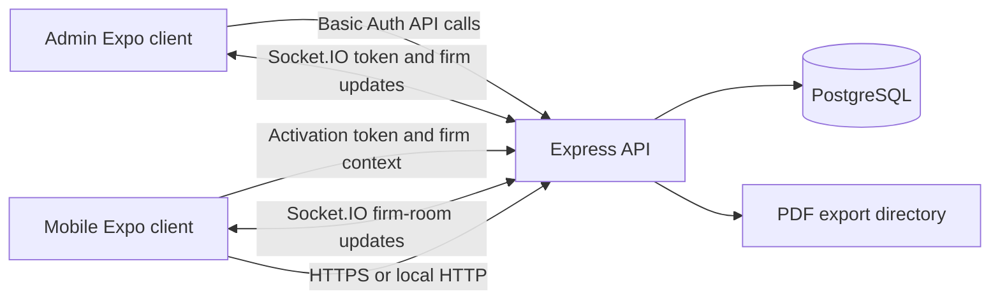

# LearnApp / Vyapar - Technical System Guide

This document describes the application as it is implemented in this repository. It is intended as a technical handoff: a reader should be able to understand the products, major user journeys, data model, APIs, local development setup, deployment shape, and important operational risks without relying on the older proposal documents.

> **Source and security note:** This guide was written from the checked-in source on October 6, 2026. It intentionally does not reproduce credentials, API secrets, database URLs, or customer data. Before sharing the repository itself, review the security notes below: some source files contain hard-coded authentication/encryption material, and `backend/test_db.js` contains password-guessing test code. Do not run or distribute that script as an operational utility.

## 1. Product Overview

LearnApp (the mobile app is branded **Vyapar**) is a business record and reporting system for multiple firms. It consists of three separately run applications:

| Application | Location | Purpose |
|---|---|---|
| Mobile client | `mobile/` | Firm users create and review business entries, maintain shared dropdown lists, mark records, review bills/quality reports, and export PDFs. Runs as an Expo React Native app on Android/iOS and has a web target. |
| Admin client | `admin/` | A super-admin creates/deletes firms, issues activation tokens, monitors token state, and manages token access and PIN resets. Built with Expo/React Native and React Native Web. |
| API and database service | `backend/` | Express API, PostgreSQL persistence, token and firm management, Socket.IO events, and PDF generation/file delivery. |

The backend does **not** currently serve the admin web build. The admin client and mobile client are separate deployments that call the API. `mobile/netlify.toml` configures an Expo web build for Netlify; local admin web development is run from `admin/`.

## 2. Architecture at a Glance



The PostgreSQL database is shared by all firms. Business records and reusable lists carry a `firm_id`; database queries in the business API use the firm ID from the request's `x-firm-id` header. Activation tokens are associated with one firm and, after activation, one device ID.

Important distinction: firm scoping exists in the business queries, but the current API does not derive/verify the firm ID from a validated activation session on every request. See [Security and Operational Limitations](#13-security-and-operational-limitations).

## 3. Repository Map

```text
learnapp/
├── README.md                         # This source-verified handoff guide
├── IMPLEMENTATION_DOCUMENTATION.md   # Earlier implementation overview; verify against source
├── implementation_plan.md            # Admin architecture proposal/plan, not a guaranteed current state
├── MULTI_TENANT_AUTH_PLAN.md          # Earlier auth design proposal, not the implemented login flow
├── SECURITY_FIXES.md                  # Security review/to-do notes; compare with current code
├── admin/                             # Expo admin client
│   ├── App.js
│   └── src/{api,screens}/
├── backend/                           # Express API, PostgreSQL, PDF export
│   ├── server.js
│   ├── db.js
│   ├── exports/
│   └── fonts/
└── mobile/                            # Expo firm-facing client
    ├── App.js
    └── src/{api,components,context,screens,utils}/
```

The old plan documents are useful for history and intent, but this README and the current code should be used to understand present behavior. In particular, the proposed username/password/JWT flow in `MULTI_TENANT_AUTH_PLAN.md` is not the mobile activation flow implemented in `mobile/`.

## 4. Technology Stack

| Layer | Main technologies |
|---|---|
| Mobile | Expo SDK 54, React 19, React Native 0.81, React Navigation bottom tabs, Axios, AsyncStorage/SecureStore, Expo native modules |
| Admin | Expo SDK 54, React 19, React Native Web, React Navigation, Axios, Socket.IO client |
| Backend | Node.js, Express 4, PostgreSQL via `pg`, Socket.IO, Helmet, CORS, `express-rate-limit`, CryptoJS |
| Reports | Puppeteer/Chromium generates A4 landscape PDFs; Gujarati font support is downloaded/loaded by the backend |
| Web deployment config | Expo web export; `mobile/netlify.toml` publishes `dist` and rewrites routes to `index.html` |

The package manifests do not declare a specific Node.js runtime version. Use a currently supported Node.js release compatible with Expo SDK 54 and the installed dependencies.

## 5. Main User Journeys

### 5.1 Admin login and dashboard

1. The admin enters a username and password in `admin/src/screens/LoginScreen.js`.
2. `checkCredentials()` calls `GET /api/admin/firms` with an HTTP Basic Authorization header. However, this check uses raw Axios and expects `response.data.success` without decrypting the response.
3. The header is stored in AsyncStorage as `admin_auth_header`; a legacy `admin_logged_in` flag is also written.
4. `admin/App.js` restores the stored header on app startup. The dashboard loads firms and tokens and opens a Socket.IO connection.
5. A `401` during dashboard data loading logs the admin out. Sign out clears the stored values and in-memory header.

This is Basic Auth, not a server-issued session/JWT. The current client persists a reusable Basic Auth header. There is also a likely login defect: the backend's global response middleware encrypts JSON responses, while `checkCredentials()` does not use the admin API response decryptor. Verify/fix this mismatch before relying on admin login; normal admin API calls do use the decrypting Axios instance.

### 5.2 Firm creation and token issuance

1. An admin creates a firm in the Firms view (`POST /api/admin/firms`). Firm names are unique in the database.
2. The admin opens Issue Token, chooses a firm, enters a required identity/username label, and selects a preset duration or custom years/months/days/hours/minutes/seconds.
3. The backend generates a random 16-byte value encoded as uppercase hexadecimal, records its firm, label, expiry, and unused state, and returns the token once to the screen.
4. The admin copies the token and gives it to the intended user. The identity label is metadata; it is not a mobile username/password login.

Custom duration conversion treats a year as 365 days and a month as 30 days. Token status is derived from expiry, `is_used`, and the special revoked device marker.

### 5.3 Mobile activation and session recovery

1. On startup, `mobile/App.js` reads or creates a device ID. Android uses `Application.androidId` when available; iOS uses the vendor ID; web creates a random ID. The value is persisted.
2. If no valid activation is present, the Activation screen asks for a token. The app uppercases it and sends the token and device ID to `POST /api/activate`.
3. The backend checks that the token exists, is unused, and has not expired; then it marks the token used and associates the device ID. The response contains firm ID/name, identity label, expiry, and token.
4. The app stores activation and firm metadata and shows the four-tab application.
5. The app checks activation at startup, on resume, and every five minutes. An explicit `valid: false` clears activation and PIN state. Network errors retain the local session rather than logging the user out.

### 5.4 Business record lifecycle

1. The user adds Name, Item, Godown, and Quality values on the Create tab. Lists are stored server-side per firm and synchronized to other clients over Socket.IO.
2. The user creates an entry on Main Page. Weight, amount, commission, and total are calculated in the form; the entry is written to PostgreSQL with the current firm ID.
3. Main Page supports search, date filtering, Available/Marked filtering, selection, edit, delete, mark, undo-mark, and main PDF export.
4. Bill Page shows entries with a bill number grouped by party, date, and bill number; opening a group shows line items and calculated bill totals. Selected groups can be exported.
5. Quality shows entries with quality/item/godown/date/status filters, aggregates unmarked selections, supports mark/undo, and exports a quality report.
6. The server emits entry/list updates to Socket.IO rooms named for a firm. Connected clients update their local screen state when those events arrive.

### 5.5 App lock and panic behavior

- A user can set, change, or disable a four-digit app-lock PIN. The client stores a salted SHA-256 hash and salt through `mobile/src/utils/storage.js`; on native platforms the storage wrapper uses Expo SecureStore and migrates older AsyncStorage values. Web uses AsyncStorage.
- PIN metadata is synchronized with the activation token so an admin can set/clear a PIN or require a reset. On the next successful status sync, the app applies the remote PIN state.
- The mobile app polls token state and syncs remote panic/PIN state. On supported native builds it also configures FreeRASP threat callbacks and listens for a three-change hardware-volume sequence within two seconds. Triggering panic blanks the main app view locally and attempts to notify the backend.
- Native security modules are skipped on web and in Expo Go. The current FreeRASP configuration includes placeholder certificate/email values, so it must not be represented as production-verified device attestation.

## 6. Mobile Screens and Business Rules

### Main Page (Payment List)

The Main Page displays all firm entries, search/date/status filters, summary totals, selection, and an add/edit form. Long-pressing an unmarked row or tapping Edit opens the edit form. Marked rows can be unmarked; selecting rows allows batch marking, deletion, or PDF export.

Form calculations in `mobile/src/screens/MainScreen.js`:

- Weight = `bharti1a × bharti1b + bharti2b` (the second pair uses a multiplier of one).
- Amount = `(rate - lessrate) × weight / 20`.
- Default commission = 1.5% of Amount; Safi mode sets commission to zero. The commission can be manually edited.
- Total = Amount + commission + other amount. Market fee is separately entered and persisted.

The Main Page's daily/name total is aggregated over the visible or selected entries. Main Page uses optimistic local updates for mark/delete, then rolls back or reloads if the API call fails. Entry updates are broadcast to the firm's Socket.IO room.

### Bill Page

Only entries with a non-empty bill number are listed. Groups are keyed by party name, entry date, and bill number. Opening a group shows its items and the following report calculation:

- Line base amount = `lessrate × weight × 5 / 100`.
- Commission = 1.5% of the group base amount.
- Market fee = 0.5% of the group base amount.
- Group total = base amount + commission + market fee.
- SGST and CGST are each calculated as 2.5% of the group total; subtotal adds both taxes.

Bill PDF export uses the selected groups' entry IDs. The client and backend both group by party/date/bill number.

### Quality

The Quality screen filters by Quality, Available/Marked state, Item, Godown, and date range. Marked entries cannot be selected for marking/export in the same way as available entries; undo is available on marked entries. Summary calculations use unmarked visible/selected records.

The Quality screen's amount/report formula is `rate × weight / 20`; this differs from the Main Page's stored Amount formula, which subtracts less rate. The PDF endpoint also uses `rate × weight / 20` and computes a weighted average rate.

### Create

The Create screen manages four server-backed lists: Name, Item, Godown, and Quality. Add and delete actions are optimistic and revert if the request fails. The database prevents duplicate values per firm/section.

### Language and data storage

- The mobile UI has English and Gujarati strings in `mobile/src/context/LanguageContext.js`. The in-memory language state starts as Gujarati and is not persisted across app launches.
- Activation token, device ID, firm metadata, username, PIN state, panic flag, and small preferences are stored locally. Business entries and shared lists live in PostgreSQL.
- The `bharti_pairs` entry field is represented in PostgreSQL as text containing JSON and parsed/stringified by the clients and report code.

## 7. Admin Capabilities

The dashboard has Firms, Issue Token, and Token Registry tabs.

- **Firms:** list firms, add a firm, start token issuance for a firm, and delete a firm. Deleting a firm cascades to related entries, tokens, and lists through foreign keys.
- **Issue Token:** choose a firm, set an identity label, select preset/custom validity, generate and copy a token.
- **Token Registry:** search by token/firm/label; view expiry countdown and device/use state; revoke or restore a token; delete a token; set/clear a four-digit PIN; reset panic state.
- **Realtime:** dashboard listens for `firms_update` and `tokens_update`; token lists are also refreshed by the backend every 60 seconds so expiry status updates without an admin action.

The backend exposes a firm-wide deactivate endpoint as well. The current Firms screen primarily presents delete and issue-token actions; do not assume every backend helper/endpoint is surfaced in the UI.

## 8. Data Model

Schema creation and incremental compatibility changes are in `backend/db.js`. `initDB()` runs before the HTTP server starts.

### `firms`

| Column | Meaning |
|---|---|
| `id` | Serial primary key |
| `name` | Required, unique firm name |
| `created_at` | Creation timestamp |

Initialization ensures a `Default Firm` exists to receive legacy records that do not yet have a firm ID.

### `activation_tokens`

Stores the activation code, owning firm, validity, and one-device binding. Fields include `id`, `token` (unique), `firm_id`, `expires_at`, `is_used`, `device_id`, `revoke_count`, `created_at`, `username`, `used_at`, `is_panic`, `pin_hash`, `pin_salt`, and `pin_reset_required`.

Token status rules in the backend are:

| Status | Rule |
|---|---|
| `deactivated` | `device_id` is the revoked marker |
| `expired` | Expiry timestamp is in the past |
| `in_use` | Token is marked used and has a device ID |
| `active` | Otherwise, while not expired/revoked |

### `entries`

Business records are scoped by `firm_id`. Columns include:

`id`, `firm_id`, `entry_date`, `name`, `quality`, `item`, `bags`, `bharti_pairs`, `weight`, `rate`, `lessrate`, `amount`, `commission`, `other_amount`, `total`, `market_fee`, `p_amount`, `is_marked`, `is_paid`, `bill_number`, `godown`, and `created_at`.

The database adds indexes for firm, date, name, marked state, and date/name. Existing rows without a firm are assigned to Default Firm during initialization.

### `create_lists`

Stores `id`, `firm_id`, `section`, and `value`. The unique key is `(firm_id, section, value)`. Existing unscoped list rows migrate to Default Firm.

## 9. Backend API Reference

All routes are implemented in `backend/server.js`. JSON request and response bodies are wrapped by the current application-level CryptoJS middleware when applicable; the clients transparently encrypt/decrypt those bodies. This is not a substitute for HTTPS or server-side identity checks.

### Admin routes (Basic Auth required)

| Method and path | Purpose |
|---|---|
| `GET /api/admin/firms` | List firms |
| `POST /api/admin/firms` | Create firm; body `{ name }` |
| `DELETE /api/admin/firms/:id` | Delete firm and cascading data |
| `POST /api/admin/generate-token` | Issue token; body includes `firm_id`, `username`, and duration fields |
| `GET /api/admin/tokens` | List tokens with firm name and derived status |
| `POST /api/admin/panic/reset` | Clear panic for `{ token_id }` |
| `POST /api/admin/deactivate/:firm_id` | Revoke currently valid tokens for a firm |
| `POST /api/admin/revoke-token/:id` | Revoke one token |
| `POST /api/admin/revert-token/:id` | Restore one token with a new duration |
| `DELETE /api/admin/tokens/:id` | Permanently delete one token |
| `POST /api/admin/reset-token-pin/:id` | Set or clear a token's PIN/reset state |

### Mobile activation and security routes

| Method and path | Purpose |
|---|---|
| `POST /api/activate` | Validate an unused token, bind it to a device, and return firm metadata |
| `POST /api/check-activation` | Check token/device validity and return current firm, panic, and label state |
| `POST /api/panic/trigger` | Set panic state for a matching token/device pair |
| `POST /api/activation/check-pin-status` | Read PIN metadata for a token/device |
| `POST /api/activation/update-pin` | Update or clear PIN metadata from the mobile app |

### Business and report routes

Business routes require a firm ID in the `x-firm-id` header. The server checks that a firm context is present and includes it in SQL queries; it does not presently authenticate that header against the activation token.

| Method and path | Purpose |
|---|---|
| `GET /api/entries` | List entries for firm, ordered by date/name/creation |
| `POST /api/entries` | Create an entry for firm |
| `PUT /api/entries/:id` | Update an entry only where ID and firm match |
| `DELETE /api/entries` | Batch-delete `{ entryIds }` within firm |
| `POST /api/mark-entries` | Batch set `is_marked` |
| `POST /api/pay-entries` | Batch set `is_paid` |
| `GET /api/autocomplete` | Return distinct entry names/items for firm |
| `GET /api/lists` | Read Name/Item/Godown/Quality lists for firm |
| `POST /api/lists` | Add `{ section, value }` for firm |
| `DELETE /api/lists` | Delete `{ section, value }` for firm |
| `POST /api/export/pdf` | Generate main entry/payment-list report |
| `POST /api/export/qualitywise-pdf` | Generate quality report |
| `POST /api/export/bill-pdf` | Generate grouped bill report |
| `GET /exports/:filename` | Serve generated export files from the export directory |

PDF POST bodies include selected entry IDs and a language code (`en` or `gu`). The server queries selected entries under the supplied firm ID, creates a PDF, writes it to `EXPORT_PATH`, and returns its filename. The `/exports` directory is served as static content.

## 10. Realtime Events

Socket.IO is hosted on the same HTTP server as Express.

| Event | Direction/use |
|---|---|
| `tokens_update` | Backend broadcasts the full token list/status to connected clients after admin actions and on a 60-second refresh cycle. Admin dashboard replaces its token state. |
| `firms_update` | Backend broadcasts the firm list after firm creation/deletion. Admin dashboard replaces its firm state. |
| `newEntry`, `entryUpdated`, `entriesDeleted` | Backend emits business record changes to `firm_<id>` rooms; mobile screens update locally. |
| `entriesMarked`, `entriesPaid` | Backend emits batch status changes to the firm room. |
| `listAdded`, `listDeleted` | Backend emits shared-list changes to the firm room; `ListsContext` updates the local list. |

Clients provide `firmId` in the Socket.IO handshake query, and the backend joins that room. That query value is not authenticated. In addition, the admin token/firm broadcasts use global `io.emit`, not a protected admin room.

## 11. Security, Configuration, and Data Boundaries

### Current controls

- Helmet security headers are enabled, with several options relaxed for app compatibility.
- `express-rate-limit` is attached to API paths. The limits are increased/skipped in development according to `NODE_ENV`.
- Admin HTTP routes check Basic Auth against server-side configured values, with insecure fallback defaults currently present in source.
- Business SQL is parameterized and most record mutations include a firm filter.
- Native mobile storage prefers SecureStore; local PIN values are salted and hashed before storage/sync.

### Material limitations to address before production or external repository sharing

1. **Secrets embedded in clients/server:** The shared payload-encryption key is hard-coded in the backend and both clients. Anything packaged into a client is recoverable; this encryption must not be treated as a secret or as transport security. Rotate/remove it and use HTTPS.
2. **Admin credential defaults and persistence:** The server has fallback admin credentials in code. The client persists a reusable Basic Auth header. Use unique environment-provided credentials, remove defaults, and consider a short-lived server-issued session model.
3. **Firm identity is not authenticated for business APIs:** `x-firm-id` is client supplied. Possession of any valid firm ID may be enough to request that firm's data through unprotected business routes. Verify the activation token/device against the firm on every protected request, or replace this mechanism with authenticated sessions.
4. **Socket.IO is not authenticated:** Clients may request a firm room by query parameter; admin-wide token/firm updates are broadcast to all connected sockets. Protect socket connections and scope events server-side.
5. **CORS currently allows requests:** The configured origin callback permits requests in both branches. Do not treat `ALLOWED_ORIGINS` as an effective restriction in the current implementation.
6. **Exports are publicly served:** Generated PDF paths are exposed under static `/exports`. Add authorization, non-guessable access, retention/cleanup, and private storage if reports contain business data.
7. **PIN endpoint checks are incomplete:** PIN status/update endpoints should verify both token ownership and the currently bound device/validity before reading or changing PIN metadata.
8. **Repository test utility:** `backend/test_db.js` contains hard-coded password-guessing code. Do not run it against a real database or share it as a test tool; remove it or replace it with a safe, explicit connectivity check that uses environment variables.
9. **Native threat configuration is placeholder:** FreeRASP certificate/email configuration includes placeholders; verify production signing values and behavior before relying on it.

Application-layer AES uses a static key distributed to clients, so it does not protect against a determined client or replace HTTPS. Production traffic should use TLS, and sensitive values should only be provided through deployment environment variables/secrets management.

## 12. Local Development and Deployment

### Prerequisites

- Node.js and npm compatible with the package manifests.
- A PostgreSQL database reachable by the backend.
- For full native testing: Expo-compatible Android/iOS tooling and the required platform SDKs.
- Puppeteer requires a compatible Chromium runtime for PDF generation; the package manages its browser installation according to its supported setup.

### Backend

Set `DATABASE_URL` in the backend environment before starting the service. Never commit a `.env` file or paste its contents into shared documentation. Supported backend settings include:

| Variable | Purpose |
|---|---|
| `DATABASE_URL` | PostgreSQL connection string; required |
| `PORT` | HTTP port; defaults to `3001` |
| `ADMIN_USERNAME`, `ADMIN_PASSWORD` | Admin Basic Auth values; currently have source-code fallbacks that should be removed |
| `ALLOWED_ORIGINS` | Intended comma-separated CORS allowlist; current callback does not enforce it |
| `EXPORT_PATH` | PDF output directory; defaults to `backend/exports` |
| `NODE_ENV` | Controls rate-limit development behavior |

From `backend/`:

```sh
npm install
npm run dev
```

`npm start` runs `node server.js`. On startup, the server initializes/migrates tables, ensures the Gujarati font directory/font, then listens on `PORT` or 3001. If database initialization fails, the process exits. PDF font initialization may download the Gujarati font if it is absent.

The PostgreSQL pool uses SSL for non-local connection strings with certificate verification disabled. Review and harden this policy for the chosen production database provider.

### Mobile client

From `mobile/`:

```sh
npm install
npm start
```

Useful scripts are `npm run android`, `npm run ios`, `npm run web`, and `npm run build:web`. The API base URL is `EXPO_PUBLIC_API_URL` when set; otherwise development uses the web hostname or Expo host IP with port 3001, and production falls back to a configured Railway API URL in source. Set the environment value deliberately for each build/deployment rather than relying on a developer's LAN address.

### Admin client

From `admin/`:

```sh
npm install
npm start
```

Use `npm run web` for local browser development and `npm run build:web` to export the web build to `admin/dist`. The API URL is selected in `admin/src/api/admin.js` from development host logic or a production URL in source; `admin/app.json` also has an `extra.apiUrl` value, but the current API helper does not read that field. The backend does not currently mount `admin/dist` at `/admin`.

### Web deployment

`mobile/netlify.toml` runs `npm run build:web`, publishes `dist`, and rewrites routes to `index.html`. Configure the Netlify base directory as `mobile/` and set `EXPO_PUBLIC_API_URL` during build. Admin web deployment is separate and requires its own hosting/rewrite setup; do not assume the backend serves it.

EAS Android build profiles are defined in `mobile/eas.json` (`development`, `preview`, `production`). Check current Expo/EAS requirements before building; the project also has an `AGENTS.md` under `mobile/` pointing contributors to versioned Expo documentation.

## 13. Operational Notes and Known Gaps

- There is no root npm workspace or unified install command; install dependencies separately in `backend/`, `mobile/`, and `admin/`.
- `backend/package.json` defines `start` and `dev`, but no automated test script. The similarly named `test_db.js` is not a safe or standard test suite.
- Admin login should be tested after fixing/confirming the raw-Axios versus encrypted-response mismatch described in Section 5.1.
- The backend automatically creates and migrates tables at startup. Back up the database before deploying schema changes, and test migrations against a copy of production data.
- `Default Firm` is a migration target for old rows, not necessarily a firm that should be exposed as a normal customer organization.
- The mobile production API URL and admin production API URL are currently source-configured fallbacks. Keep environment/deployment config synchronized when changing backend hosting.
- PDF exports are written to disk and no cleanup/retention job is defined in the reviewed source. Monitor storage usage.
- The API's export HTML is assembled from entry fields. Validate/escape user-controlled content before rendering in Chromium.
- No verified CI/test suite or deployment pipeline is declared in the package manifests and files reviewed for this guide.

## 14. Source File Guide

### Backend

- `backend/server.js` - Express middleware, authentication checks, API routes, Socket.IO, PDF rendering, startup.
- `backend/db.js` - PostgreSQL pool, schema creation, migrations, indexes, legacy-row assignment.
- `backend/package.json` - backend scripts and dependencies.
- `backend/exports/` - generated PDF output by default.
- `backend/fonts/` - Gujarati PDF font assets/cache.

### Mobile

- `mobile/App.js` - device identity, activation/session lifecycle, app lock, panic handling, navigation and providers.
- `mobile/src/api/config.js` - API URL, firm header, payload encryption/decryption.
- `mobile/src/api/entries.js` - API methods for activation, entries, lists, status, and report export.
- `mobile/src/context/ListsContext.js` - list fetch, optimistic writes, firm Socket.IO listeners.
- `mobile/src/context/LanguageContext.js` - English/Gujarati strings and toggle.
- `mobile/src/screens/MainScreen.js` - entry list/form/calculations/actions.
- `mobile/src/screens/BillScreen.js` - bill grouping, calculations, bill PDF selection.
- `mobile/src/screens/QualityScreen.js` - quality filters, aggregate, marking and export.
- `mobile/src/screens/CreateScreen.js` - shared list management.
- `mobile/src/screens/ActivationScreen.js` - first-time token activation.
- `mobile/src/components/` - app lock, date/dropdown controls, PDF viewer and related UI.
- `mobile/src/utils/storage.js` - SecureStore/AsyncStorage abstraction and migration.
- `mobile/src/utils/security.js` - PIN hashing, local state and backend PIN synchronization.

### Admin

- `admin/App.js` - restore persisted Basic Auth header and choose login/dashboard.
- `admin/src/api/admin.js` - API base URL, Basic Auth, payload encryption, admin endpoint functions.
- `admin/src/screens/LoginScreen.js` - credential entry and API validation.
- `admin/src/screens/DashboardScreen.js` - tab state, initial loads, Socket.IO updates, logout on 401.
- `admin/src/screens/FirmsScreen.js` - create/delete firms and quick token navigation.
- `admin/src/screens/GenerateTokenScreen.js` - token duration, firm/label inputs, copy result.
- `admin/src/screens/TokensScreen.js` - search/status, revoke/restore/delete, PIN and panic actions.

## 15. Older Documentation

- `IMPLEMENTATION_DOCUMENTATION.md` is an earlier overview and should be checked against this README and current source before reuse.
- `implementation_plan.md` is a proposed admin architecture and feature plan; some items are not implemented in the current tree.
- `MULTI_TENANT_AUTH_PLAN.md` describes a different planned username/password/JWT approach. Current mobile access is activation-token based.
- `SECURITY_FIXES.md` is a security to-do document. Its items should be re-audited against the current implementation and not assumed completed just because the implementation overview uses security language.

## 16. Recommended Reading Order for a New Engineer

1. Read this README for the product map, flows, and caveats.
2. Read `backend/db.js` to understand persisted data and migrations.
3. Read the route groups in `backend/server.js`, starting with admin and activation, then firm-scoped entries/lists, then PDF exports.
4. Follow the mobile startup flow in `mobile/App.js`, then `mobile/src/api/config.js` and `mobile/src/api/entries.js`.
5. Read the four mobile screens and `ListsContext.js` for user-facing business behavior.
6. Read the admin API and screen modules to follow firm/token administration.
7. Resolve the security limitations in Section 11 before treating the system as production-secure or sharing the complete repository publicly.

---

This guide is a map of the implementation, not a security certification or a substitute for validating behavior against the deployed environment.